# ATM (Ats Task Manager)

macOS 메뉴바에 상주하는 플로팅 위젯이다. 한 패널에서 다음을 본다.

- **할 일**: 마감일·태그·메모·하위 할 일, 그리고 내게 할당된 Jira 미완료 이슈
- **요약**: Claude Code 세션을 바탕으로 한 하루·주간 업무 요약
- **노트**: 잠글 수 있는 메모, 자주 여는 링크, Confluence 에서 별표한 문서
- **PR**: GitHub·Bitbucket 리뷰 요청과 내 PR 의 승인 상태
- **Teleport**: DB 터널 자동 로그인·유지

탭은 설정 > 창·일반 > 탭에서 켜고 끈다.

<p align="center">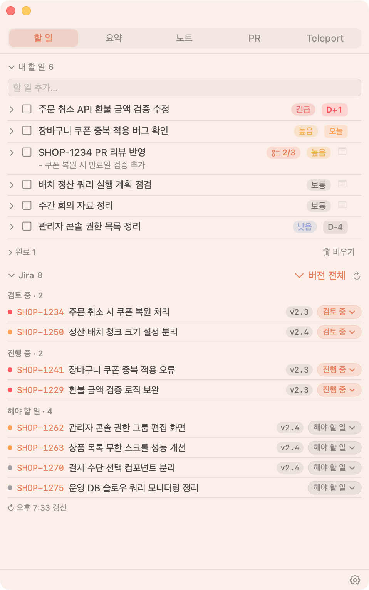</p>
<p align="center"><sub>할 일(위)과 Jira 이슈(아래)를 한 화면에 모아 보여 준다.</sub></p>

## 설치

### 준비물

- macOS 14 이상, Command Line Tools 의 Swift 5.10 이상 (`swift --version` 으로 확인, `make doctor` 가 같이 점검)
- Xcode 명령줄 도구 (이미 있으면 생략)

```bash
xcode-select --install
swift --version
```

- 요약 기능을 쓰려면 Claude Code CLI에 로그인되어 있어야 한다.

```bash
claude --version
```

### 설치

```bash
git clone https://github.com/tkdals2317/mac-task-manage-widget.git
cd mac-task-manage-widget
make install
open ~/Applications/ATM.app
```

앱은 `~/Applications/ATM.app` 에 설치된다. `make install` 은 먼저 `make doctor` 로 환경을 점검하고, ❌ 가 있으면 안내 메시지와 함께 멈춘다.

> **Claude Code로 설치하기**: Claude Code 에 아래를 붙여넣는다.
>
> "https://github.com/tkdals2317/mac-task-manage-widget 를 ~/mac-task-manage-widget 에 클론하고 README 설치 순서대로 설치해줘. 먼저 make doctor 를 돌려서 ❌ 가 있으면, 나한테 sudo ./scripts/fix-clt.sh 한 줄만 실행해 달라고 해."

### 처음 설정

처음 실행하면 **설정 도우미**가 뜬다. 쓸 기능(Jira·노트·요약·PR·Teleport)을 고르면, 고른 기능에 필요한 설정만 차례로 안내한다.

- 비밀 정보 저장 위치(키체인 / 파일)
- Atlassian 계정(Jira·Confluence 주소, API 토큰) 연결 확인
- 노트 잠금 비밀번호와 Touch ID
- Claude 연동(활동 훅, 할 일 추가 스킬)과 요약 시각
- PR: GitHub(`gh` 로그인)과 Bitbucket(API 토큰, 리뷰 요청을 볼 저장소)
- Teleport 로그인과 쓸 DB 고르기
- 테마, 패널 열기 단축키, 로그인 시 실행

도우미는 설정 > 정보 > **설정 도우미 열기**로 언제든 다시 연다 (지금 값이 채워진 채로 열린다). 도우미 없이 직접 하려면 패널 맨 아래 ⚙(설정)에서 아래를 한다.

1. **Jira**: Jira 주소(예: `https://your-site.atlassian.net`)와 이메일을 입력하고 "토큰 발급 ↗"로 API 토큰을 만들어 붙여넣은 뒤 저장 → 연결 테스트. 키체인 창이 뜨면 **항상 허용**을 누른다 (창이 싫으면 설정 > 창·일반 > 비밀 정보 저장 에서 **파일**을 고를 수 있다).
2. **Claude 연동**: "활동 훅 설치", "/worklog 스킬 설치", "할 일 추가 스킬 (atm-todo) 설치". 훅은 새 Claude Code 세션부터 기록한다.
   - atm-todo 스킬을 설치하면 Claude Code 에서 "이거 할 일에 추가해줘, 금요일까지" 처럼 말해 ATM 할 일을 추가할 수 있다. 내부적으로 `ATM.app/Contents/MacOS/TaskWidget --add-todo --title "..." [--due YYYY-MM-DD] [--tag 이름] [--memo "..."] [--sub "..."]` 를 실행하며, 앱이 꺼져 있으면 다음 실행 때 반영된다. 앱을 옮기면 스킬을 다시 설치한다.
3. **창·일반**: "로그인 시 실행"을 켠다.
4. **요약**: 생성 시각을 확인한다 (기본 18:00).

## 사용 설명서

### 할 일

- 입력창에 적고 Enter 를 누르면 추가된다.
- 📅/배지를 눌러 마감일을 정한다 (오늘 / 내일 / 다음 주 월 / 마감 없음 또는 달력). 지난 마감은 빨강, 오늘은 주황으로 표시된다.
- 제목을 더블클릭하면 바로 수정된다 (Enter 저장, Esc 취소).
- 줄 왼쪽 ▸ 를 누르면 "메모"와 "하위 할 일"이 펼쳐진다. 메모를 누르면 그 자리에서 여러 줄 편집기가 된다 (입력 즉시 저장, Esc 또는 바깥 클릭으로 닫힘).
- 하위 할 일은 체크·마감일을 따로 두고, 더블클릭으로 이름을 바꾸고, 마우스를 올리면 나오는 ✕ 로 지운다. 상위를 완료하면 하위도 모두 완료되며, 하위를 다 끝내도 상위는 자동 완료되지 않는다. 마감이 오늘·지난 하위 할 일도 메뉴바 개수에 들어간다.
- 접힌 줄에는 오른쪽에 하위 할 일 진행 알약(☑ 2/4, 다 끝나면 강조색으로 채워짐)이, 제목 아래에 메모 첫 줄이 보인다. 알약을 누르면 펼쳐진다.
- 노란 버튼은 패널을 Dock 으로 최소화한다. Dock 아이콘이나 메뉴바 아이콘을 누르면 다시 나타난다.
- 설정 > 창·일반 > 탭에서 탭을 켜고 끌 수 있다 (하나만 켜면 탭 바가 숨겨진다).

**태그**

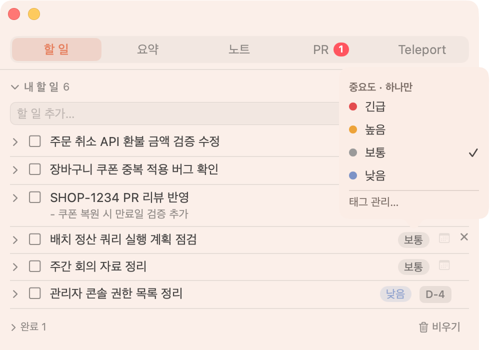

<sub>할 일 오른쪽의 태그 영역을 누르면 그룹별 태그 선택 팝오버가 열린다. "중요도"는 하나만, "작업 종류"는 여러 개 고를 수 있다.</sub>

- 태그는 그룹에 속하고, 그룹마다 "하나만"(같은 그룹에서 하나만 붙음) 또는 "여러 개"를 고른다.
- 태그 영역(없으면 호버 시 "＋태그")을 누르거나 우클릭 메뉴(그룹별 하위 메뉴)로 토글한다.
- 행에는 그룹 순서 → 태그 순서대로 최대 2개와 "+N" 이 보인다.
- "태그 순서로 정렬"(기본 켜짐)이면 "정렬 기준" 그룹의 태그 순서 → 마감 → 생성 순으로 정렬된다 (그 그룹 태그가 없는 할 일은 뒤).
- 그룹·태그 추가/삭제/이름 변경/드래그 순서, 색 지정, 기본값 복원은 설정 > 태그에서 한다.

### 노트

메모와 링크를 한 탭에 모은다.

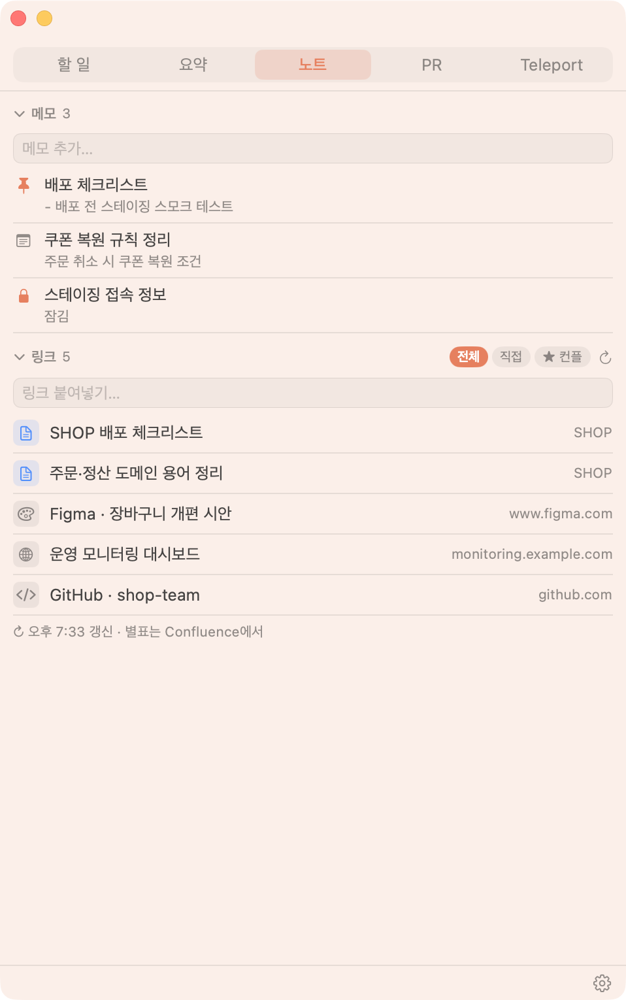

<sub>위는 메모(고정 · 잠금), 아래는 링크와 Confluence 별표 문서.</sub>

**메모**

- "메모 추가…"에 제목을 쓰고 Enter. 줄을 누르면 펼쳐져 여러 줄로 쓴다 (입력 즉시 저장).
- 마우스를 올리면 나오는 버튼이나 우클릭으로 고정·잠그기·삭제를 한다. 제목은 더블클릭으로 바꾼다.
- **잠금**: 메모마다 잠글 수 있다. 처음 잠글 때 잠금 비밀번호를 정한다 (모든 메모가 같은 비밀번호를 쓴다). 잠긴 메모는 제목만 보이고 내용은 암호화돼 저장된다.
  - 잠긴 메모의 **열기**를 누르면 Touch ID(켜 둔 경우) 또는 비밀번호로 연다.
  - 5분이 지나거나, 패널을 닫거나, 화면이 잠기거나, Mac 이 잠들면 다시 잠긴다. "지금 잠그기"로 바로 잠근다.
  - 비밀번호를 잊으면 잠긴 메모는 되살릴 수 없다. 설정 > 노트 > 초기화는 잠긴 메모를 지운다.

**링크**

- "링크 붙여넣기…"에 주소를 붙여넣으면 저장되고 페이지 제목이 자동으로 채워진다. 누르면 브라우저로 열린다.
- 마우스를 올리면 주소 복사 · 수정(✏️) · 삭제 버튼이 나온다. 수정에서 이름을 비우면 새 주소의 페이지 제목을 다시 가져온다.
- **Confluence 별표 문서**: 설정 > 노트에 Confluence 주소(예: `https://회사.atlassian.net`)를 넣으면 내가 Confluence 에서 별표한 문서가 자동으로 같이 보인다. Jira 와 같은 Atlassian 토큰을 쓴다.
- 위쪽 칩으로 전체 / 직접 저장한 것 / ★ 컨플만 골라 본다.

### Teleport

DB 접속용 Teleport 터널을 ATM 안에서 켜고 끈다. 로그인(비밀번호 + OTP)은 ATM 이 대신 입력한다.

**준비물**

- `tsh` 설치 (`make doctor` 가 확인한다. 없으면 탭에 설치 링크가 나온다).
- Teleport 사용자 ID, 비밀번호, OTP 키. OTP 키는 아래 중 하나면 된다.
  - base32 키 문자열
  - `otpauth://totp/...?secret=...` 주소 (OTP 앱·브라우저 확장에서 내보낸 것)
  - OTP 등록 QR 코드 캡처 이미지 ("QR 이미지로 읽기")
  - OTP 키를 어디서 구하는지 모르겠으면 → [OTP 키 구하는 법](docs/otp-key.md) (휴대폰 OTP 앱 / 브라우저 확장별 안내)

**처음 설정**

1. 설정 > 창·일반 > 탭에서 **Teleport** 를 켠다 (기본 꺼짐).
2. Teleport 탭의 **1/2 계정** 에서 프록시, 사용자 ID, 비밀번호, OTP 키를 넣는다.
   - 사용자 ID 는 Teleport 계정이다. DB 사용자(`developer`)가 아니다. OTP 주소를 넣으면 계정이 자동으로 채워진다.
   - OTP 키 아래 "현재 코드" 6자리가 휴대폰/확장의 OTP 와 같으면 키가 맞다.

   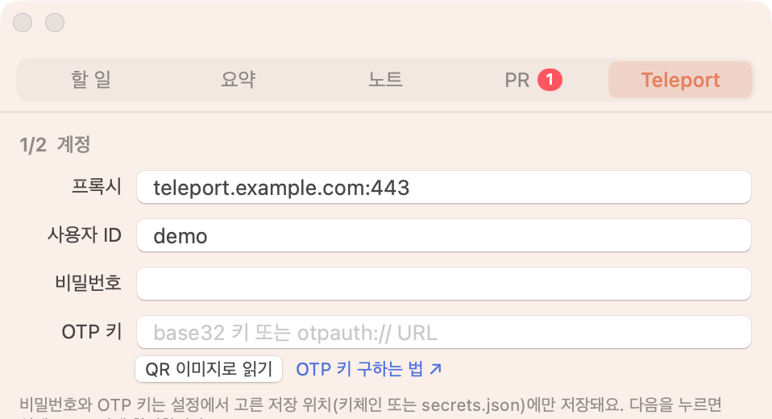

3. **다음** 을 누르면 실제로 로그인해 확인하고, 통과하면 비밀번호·OTP 키를 저장한다 (기본 키체인, 설정 > 창·일반 > 비밀 정보 저장 에서 파일로 바꿀 수 있다).
4. **2/2 DB 선택** 에서 `tsh db ls` 로 불러온 DB 를 체크한다. 포트는 4306 부터 자동으로 채워지고(수정 가능, 겹치면 빨간색), 운영 DB 는 빨간 "운영" 표시가 붙고 기본으로 선택되지 않는다 (고르면 경고가 나온다). **N개 저장** 을 누른다.

**사용**

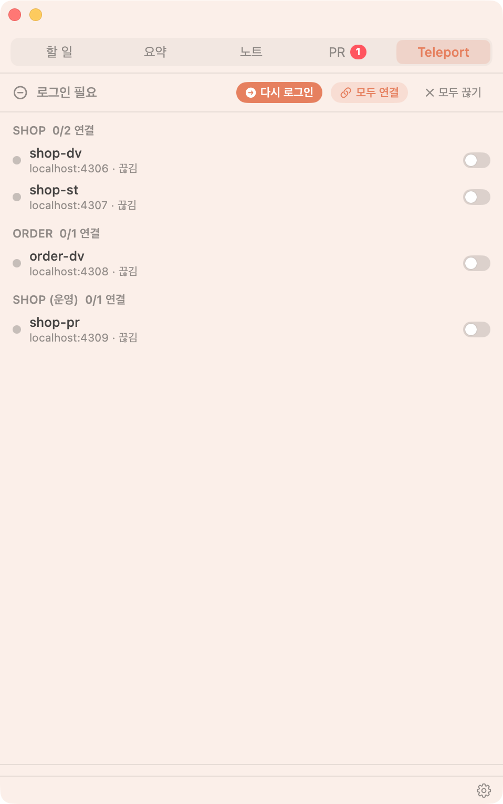

- **모두 연결 / 모두 끊기**, 또는 DB 별 토글로 켜고 끈다. 필요하면 저장된 비밀번호와 OTP 로 자동 로그인한다.
- 토글과 점은 실제 상태를 보여준다: 초록 연결됨, 주황 연결 중, 회색 끊김, 빨강 실패(이유가 아래 줄에 나온다).
- **자동 유지**: 설정한 주기(기본 1분, 설정 > Teleport 에서 30초·1분·2분·5분)마다 켜 둔 터널의 프로세스와 포트가 살아 있는지 확인한다. 로그인이 만료됐으면 자동으로 다시 로그인하고, 죽은 터널은 다시 연결한다. 실패해도 포기하지 않고 간격을 늘려(최대 5분) 계속 시도하며 "재연결 대기"로 표시한다. Mac 이 잠자기에서 깨면 바로 확인하고, 90초 넘게 멈춘 로그인은 취소 후 다시 시도한다. (DB 에 접속해 보는 확인은 세션을 많이 만들어서 하지 않는다.)
- DB 툴 접속 정보: 호스트 `localhost`, 해당 포트, DB 사용자(기본 `developer`), 비밀번호 없음.
- **자동 재연결**: ATM 을 켜면 마지막에 켜 두었던 DB 를 자동으로 다시 연결한다(로그인이 필요하면 자동 로그인). 설정 > Teleport 에서 끌 수 있다.
- ATM 을 끄면(업데이트·`make install` 포함) ATM 이 연 터널을 닫고 `tsh logout` 한다. 다음에 켜면 위 자동 재연결이 다시 연다.
- 다른 프로그램이 그 포트를 쓰고 있으면 "포트 사용 중"으로 표시만 하고 건드리지 않는다.

**설정 바꾸기**

- 계정이나 DB 목록을 바꾸려면 설정 > Teleport > **설정 다시 하기**.
- 그룹 이름은 DB 이름의 첫 부분(`app-dv` → APP)이다. 바꾸려면 설정 > Teleport > **teleport.json 열기** 에서 해당 DB 에 `"group": "원하는 이름"` 을 넣는다.
- 저장 위치: 비밀번호·OTP 키는 macOS 키체인 또는 `secrets.json`(저장 위치 설정에 따름), DB 목록은 `~/Library/Application Support/TaskWidget/teleport.json`, 터널 로그는 `logs/teleport-<이름>.log`.

**문제 해결**

- `ERROR: invalid username, password or second factor` / `invalid credentials`: 사용자 ID 가 Teleport 계정인지(`developer` 아님), 비밀번호, OTP 키를 확인하고 설정 다시 하기.
- "비밀번호나 OTP 키가 맞지 않아 자동 로그인을 멈췄어요": 틀린 값으로 계속 시도하다 계정이 잠기지 않게 ATM 이 자동 재로그인을 멈춘 상태다. 설정 > Teleport > **설정 다시 하기**로 다시 입력하거나 **다시 로그인**을 누른다.
- 키체인 창이 뜨면 **항상 허용** (업데이트 직후 한 번). 매번 뜨는 게 싫으면 설정 > 창·일반 > 비밀 정보 저장 을 **파일**로 바꾼다.

### PR

GitHub·Bitbucket 에서 나한테 온 **리뷰 요청**과 **내가 올린 PR** 을 모아 본다.

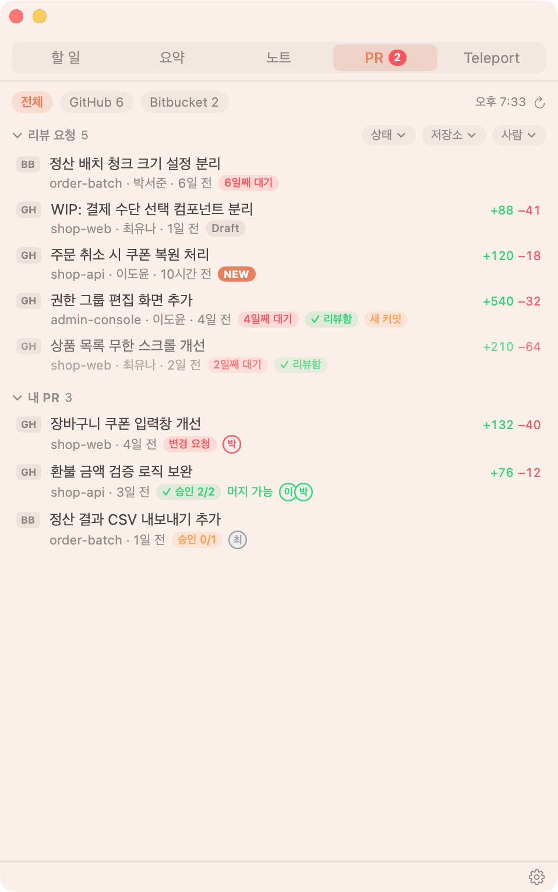

<sub>리뷰 요청(대기 일수 · NEW · 리뷰함)과 내 PR(승인 n/m · 변경 요청, 리뷰어 동그라미).</sub>

- **리뷰 요청**: 오래 기다린 것은 "N일째 대기"(기준은 설정에서), 새로 온 것은 NEW, 내가 리뷰한 뒤 새 커밋이 올라온 것은 "리뷰함 · 새 커밋"으로 표시된다.
- **내 PR**: 승인 배지(✓ 승인 n/m · 승인 대기 · 변경 요청)와 리뷰어 동그라미(초록 승인, 빨강 변경 요청, 회색 대기)가 붙는다.
- 행을 누르면 펼쳐져 리뷰어별 상태, 브랜치, 변경 규모를 보고 **열기 · 브랜치 복사 · 할 일로** 를 쓴다. 우클릭에는 체크아웃 명령 복사와 이 저장소 숨기기도 있다.
- **바로 승인**: 리뷰 요청을 펼쳐 **✓ 승인** → 확인. Bitbucket 은 승인 취소도 된다 (GitHub 은 API 로 취소가 안 돼 웹에서 한다).
- **알림**: 새 리뷰 요청, 내 PR 승인(한 명씩 n/m, 모두 승인되면 "머지할 수 있어요"), 변경 요청, 새 댓글·리뷰(PR 하나당 새로고침마다 한 번으로 묶음). 알림을 누르면 PR 이 열린다. 설정 > PR 에서 종류별로 끈다. 알림이 안 오면 시스템 설정 > 알림 > ATM 에서 허용됐는지 확인한다 (설정 > PR 에 안내가 뜬다).
- **거르기**: 리뷰 요청 머리의 **상태 ▾**(아직 리뷰 안 함 · 리뷰함·새 커밋 · 리뷰함), **저장소 ▾**, **사람 ▾** 칩으로 여러 개 골라 거른다. 거르는 중이면 개수가 "4/14" 로 보이고 ✕ 로 한 번에 푼다. 고른 값은 다음에도 유지된다.
- 탭 제목의 빨간 숫자는 아직 안 본 리뷰 요청과 변경 요청 받은 내 PR 수다.

**연결**

- **GitHub**: `gh` CLI 에 로그인돼 있으면 설정 > PR 에서 켜기만 한다 (`brew install gh` → `gh auth login`).
- **Bitbucket**: Atlassian 이메일과 범위가 있는 API 토큰을 넣고 **연결 확인**. [토큰 만드는 법](docs/bitbucket-token.md). 읽기 권한 4개가 필요하고, 바로 승인까지 쓰려면 `write:pullrequest:bitbucket` 도 체크한다.
  - Bitbucket 은 리뷰 요청을 저장소마다 물어봐야 해서 **리뷰 요청을 볼 저장소**를 고른다. 이 Mac 에 클론된 저장소와 최근 30일 안에 내가 리뷰어였던 저장소가 미리 선택된다.
  - 클론을 찾는 폴더는 설정 > PR > **클론 찾을 폴더**에서 추가·삭제한다 (기본 `~/projects` 등, 고른 폴더 아래 두 단계까지).
  - Bitbucket 에서 없어진(삭제·이름 변경·권한 회수) 저장소는 자동으로 목록에서 빠진다.

### Jira

- 내게 할당된 미완료 이슈가 상태별로 나온다. 이슈를 누르면 브라우저에서 열린다. 설정 > Jira 에서 JQL 을 바꿀 수 있다.
- 이슈 행 오른쪽에 회색 **수정 버전 태그**가 붙는다 (`PROJ_v1.2` 처럼 모든 버전에 붙은 공통 접두어 `PROJ_` 는 숨김).
- 이슈 행 오른쪽의 색 있는 상태 버튼(▾) 또는 우클릭 > 상태 변경으로 **Jira 상태를 바꾼다**. 창 맨 위에 지금 상태가 ✓ 와 함께 보이고, 아래에서 바꿀 상태를 고르면 Jira 에 바로 반영된다. 필수 입력값이 필요한 전환은 막히므로 Jira 에서 직접 바꾼다.
- 헤더의 버전 pill 로 **버전별 필터**를 건다 (× 로 해제).
- 메뉴의 "버전별로 묶기"를 켜면 버전 그룹으로 표시된다. 선택은 재실행 후에도 유지된다.

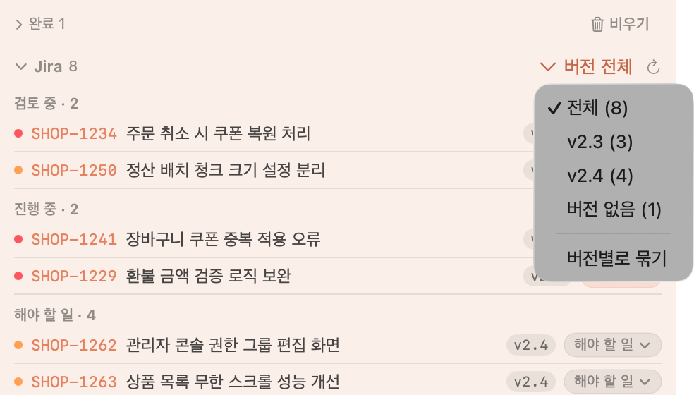

<sub>버전 pill 메뉴. 버전별 이슈 개수를 보고 필터를 고르거나 "버전별로 묶기"를 켠다.</sub>

### 업무 요약

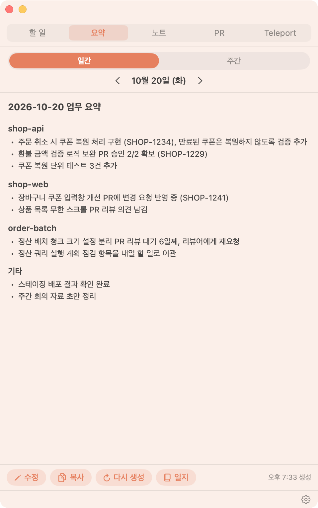

<sub>요약 탭. 위에서 일간/주간과 날짜를 고르고, 아래에서 수정 · 복사 · 다시 생성 · 일지를 쓴다.</sub>

- 매일 설정한 시각(기본 18:00)에 자동 생성된다. 그 시각에 앱이 꺼져 있었다면 다음 실행 때 지난 7일 안의 빠진 날을 채운다.
- 입력 자료
  - Claude Code 세션에서 `/worklog` 로 남긴 일지: 가장 신뢰하는 입력.
  - 활동 훅이 모은 Claude Code 대화 기록: 일지가 없는 프로젝트를 보완.
  - git 커밋: 사실 확인용.
- 요약은 `claude -p` 로 만들므로 Claude Code CLI 구독을 쓴다.
- 위쪽 **일간 / 주간** 으로 전환하고 ‹ › 로 날짜(주간은 "10월 4주차" 처럼 주 단위)를 옮긴다. 두 달에 걸친 주는 목요일이 있는 달로 센다.
- **주간 요약**은 그 주의 일간 요약을 모아 **생성** 을 눌러 만든다.
- **수정**(또는 ⌘E)으로 요약 원문(Markdown)을 직접 고친다. ⌘↩ 저장, esc 취소. 고친 요약은 아래에 "… 수정" 시각이 붙고, 다시 생성하기 전에 한 번 더 묻는다.
- 글은 여러 줄에 걸쳐 드래그로 선택해 복사할 수 있다. **복사**는 요약 전체를 클립보드에 담는다 ("요약을 복사했어요" 알림).
- **다시 생성**으로 다시 만들고, **일지**로 그날 `/worklog` 일지 파일을 연다.
- 메뉴바 아이콘 우클릭 > "요약 지금 생성"으로 바로 만들 수도 있다.

### 설정

패널 맨 아래 ⚙ 를 누르면 열린다. 왼쪽 목록에서 화면을 고른다.

| 화면 | 하는 일 |
|---|---|
| 외관 | 테마 색, 투명도, 라이트/다크, 글자 크기 |
| 창·일반 | 항상 위, 전역 단축키, 탭 켜고 끄기, 로그인 시 실행, 비밀 정보 저장 위치 |
| 태그 | 태그 그룹과 태그, 색, 정렬 기준 |
| Jira | Atlassian 계정 연결, 갱신 주기, JQL |
| 노트 | 잠금 비밀번호, Touch ID, Confluence 연결 |
| PR | GitHub·Bitbucket 연결, 볼 저장소, 알림, 표시 옵션 |
| 요약 | 생성 시각, 요약 프롬프트, claude CLI |
| Claude 연동 | 활동 훅과 스킬 설치 |
| Teleport | tsh 위치, 자동 연결, 다시 설정하기 |
| 정보 | 버전, 업데이트, 설정 도우미, 진단 정보 |

#### 외관

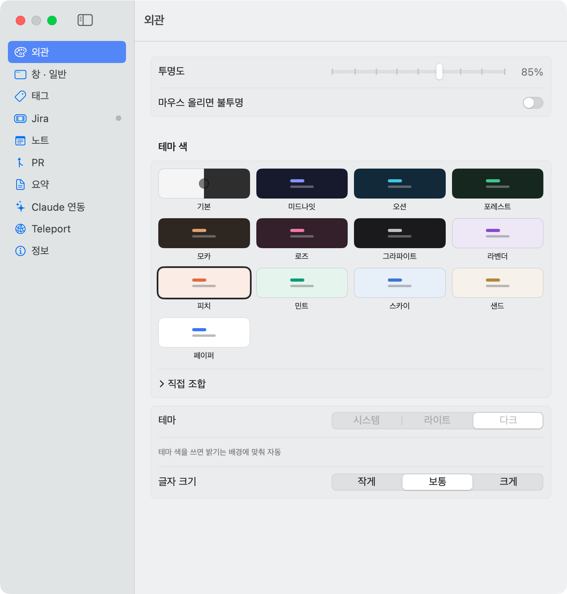 외관">

- **투명도**: 패널 바탕의 비침 정도. "마우스 올리면 불투명"을 켜면 쓰는 동안만 또렷해진다.
- **테마 색**: 완성 테마 12종(미드나잇·오션·포레스트·피치 등) 중 고른다. **직접 조합**을 펼치면 배경 20가지와 강조색 8가지를 섞는다. 강조색은 버튼·배지·선택 표시·스크롤 막대에 쓰인다.
- **테마**: 시스템을 따르거나 라이트/다크로 고정한다. **글자 크기**: 작게·보통·크게.

#### 창 · 일반

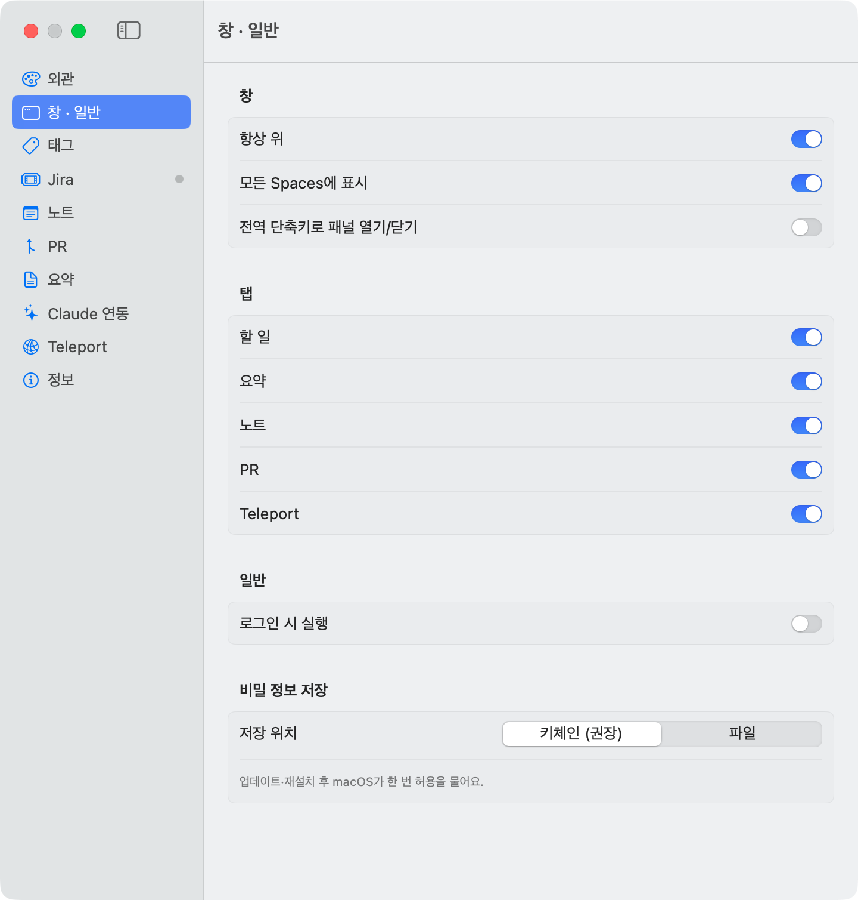 창 · 일반">

- **창**: 항상 위, 모든 Spaces 에 표시, **전역 단축키**(기본 ⌃⌥Space, 눌러서 원하는 조합으로 바꾼다).
- **탭**: 할 일·요약·노트·PR·Teleport 를 켜고 끈다. 하나만 켜면 탭 바가 숨는다.
- **로그인 시 실행**.
- **비밀 정보 저장**: 토큰·비밀번호를 **키체인**(권장)에 둘지 **파일**(`secrets.json`)에 둘지. 바꾸면 기존 값을 옮긴다.

#### 태그

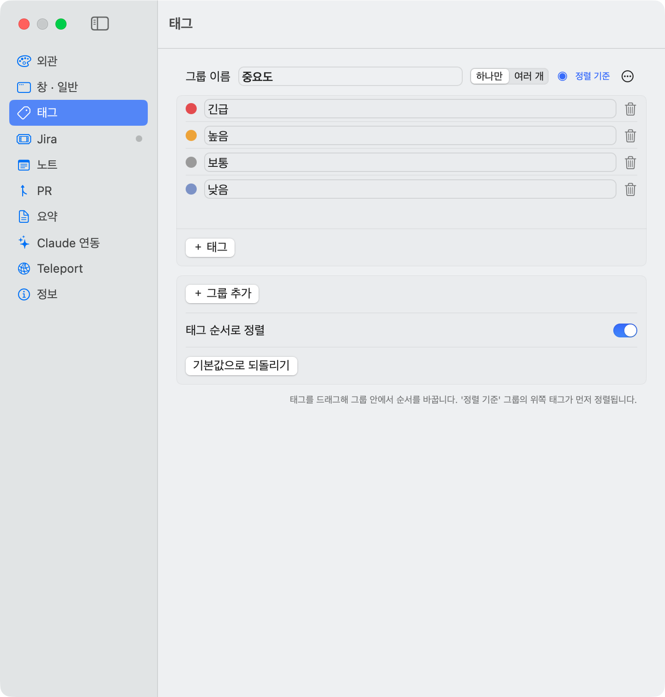 태그">

- 그룹마다 "하나만"(같은 그룹에서 하나만 붙음) 또는 "여러 개"를 고르고, 한 그룹을 **정렬 기준**으로 정한다.
- 태그 이름·색을 바꾸고, 끌어서 순서를 바꾸고, **＋ 태그 / ＋ 그룹 추가** 로 늘린다.
- **태그 순서로 정렬**을 켜면 할 일이 정렬 기준 그룹의 태그 순서대로 놓인다. **기본값으로 되돌리기**로 처음 태그로 돌아간다.

#### Jira

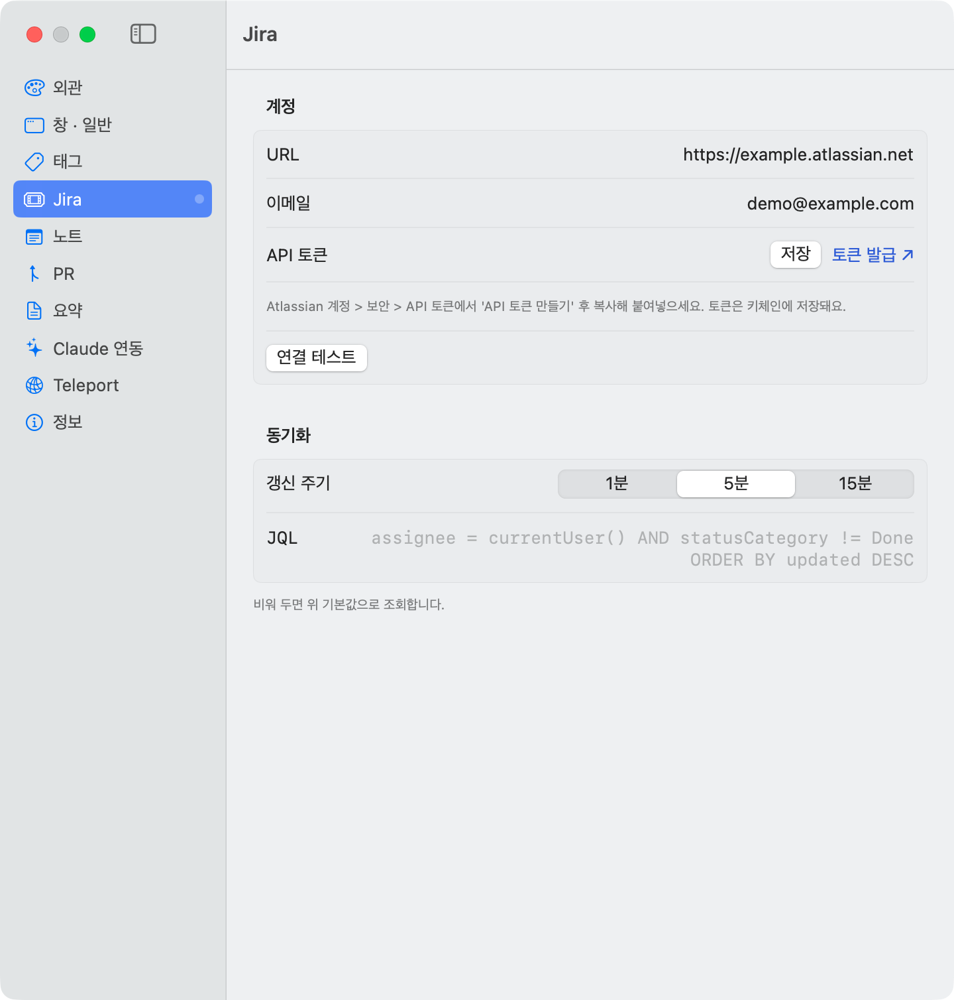 Jira">

- **URL**(예: `https://회사.atlassian.net`), **이메일**, **API 토큰**("토큰 발급 ↗"으로 만든다)을 넣고 **연결 테스트**.
- **갱신 주기**(1·5·15분)와 **JQL**(기본: 내게 할당된 미완료 이슈). 비워 두면 기본값을 쓴다.

#### 노트

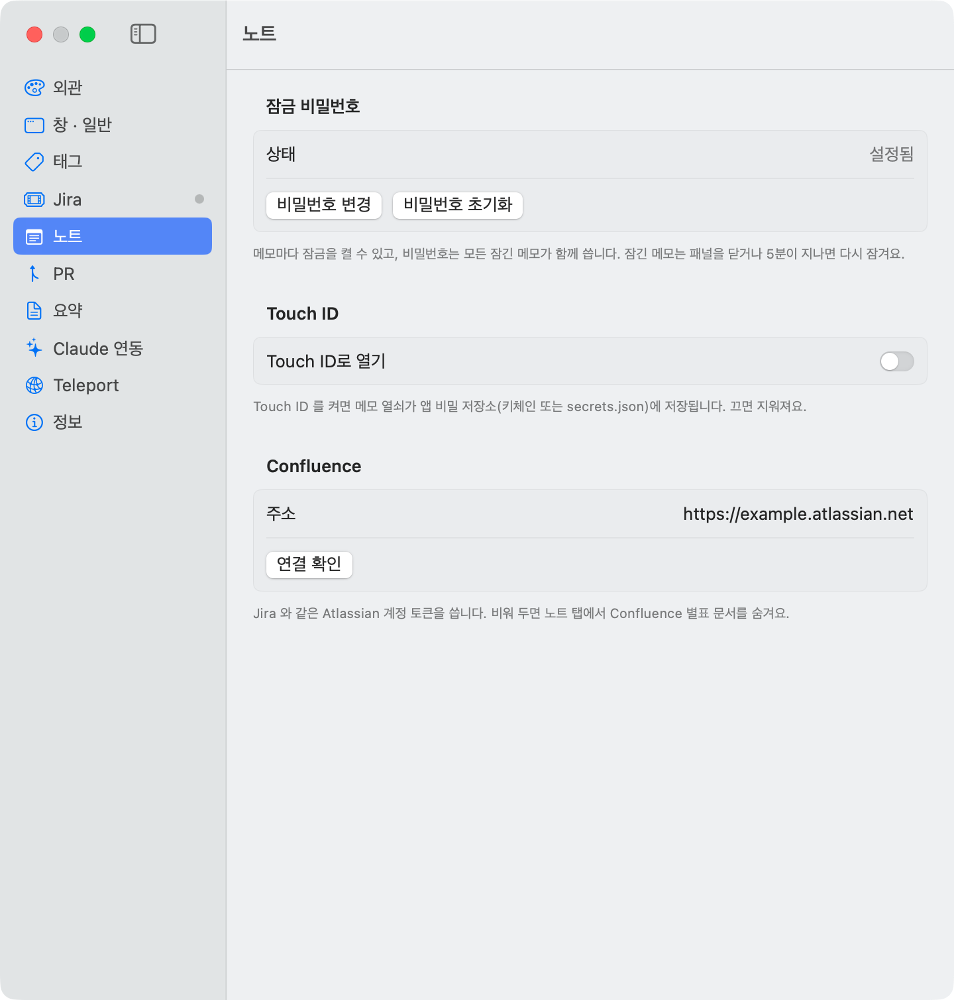 노트">

- **잠금 비밀번호**: 만들기·변경·초기화. 초기화하면 잠긴 메모는 지워진다.
- **Touch ID 로 열기**: 켜면 잠긴 메모를 지문으로 연다 (메모 열쇠가 비밀 정보 저장 위치에 보관된다).
- **Confluence**: 주소를 넣고 **연결 확인**. Jira 와 같은 Atlassian 토큰을 쓴다.

#### PR

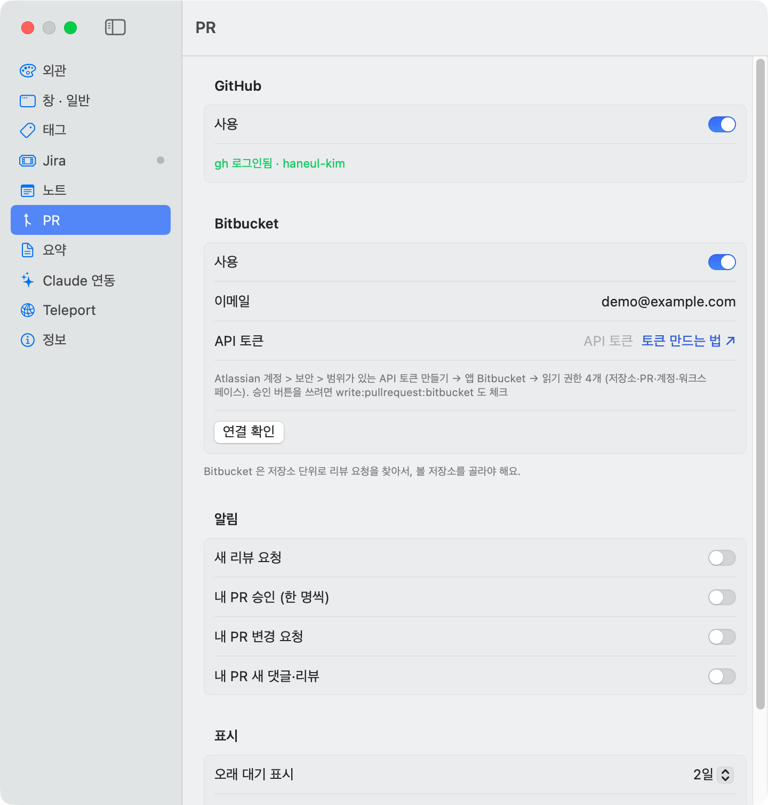 PR">

- **GitHub**: 켜면 `gh` 로그인 상태가 보인다. 로그인이 안 돼 있으면 할 명령을 알려 준다.
- **Bitbucket**: 이메일·API 토큰 → **연결 확인** → 워크스페이스, **리뷰 요청 볼 저장소**, **클론 찾을 폴더**.
- **알림**: 새 리뷰 요청 / 내 PR 승인(한 명씩) / 변경 요청 / 새 댓글·리뷰를 각각 켜고 끈다. macOS 에서 ATM 알림이 꺼져 있으면 여기 안내가 뜬다.
- **표시**: 오래 대기 기준(1~7일), Draft PR 숨기기, 새로고침 주기, 숨긴 저장소 다시 보기.

#### 요약

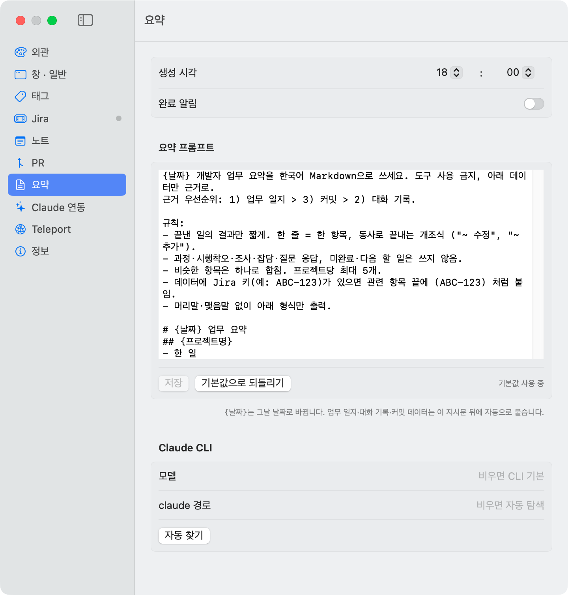 요약">

- **생성 시각**(기본 18:00)과 **완료 알림**.
- **요약 프롬프트**: 요약을 어떻게 쓸지 고친다. `{날짜}` 는 그날 날짜로 바뀌고, 일지·대화 기록·커밋은 자동으로 붙는다. **기본값으로 되돌리기**가 있다.
- **Claude CLI**: 모델과 `claude` 경로. 경로를 못 찾으면 **자동 찾기**.

#### Claude 연동

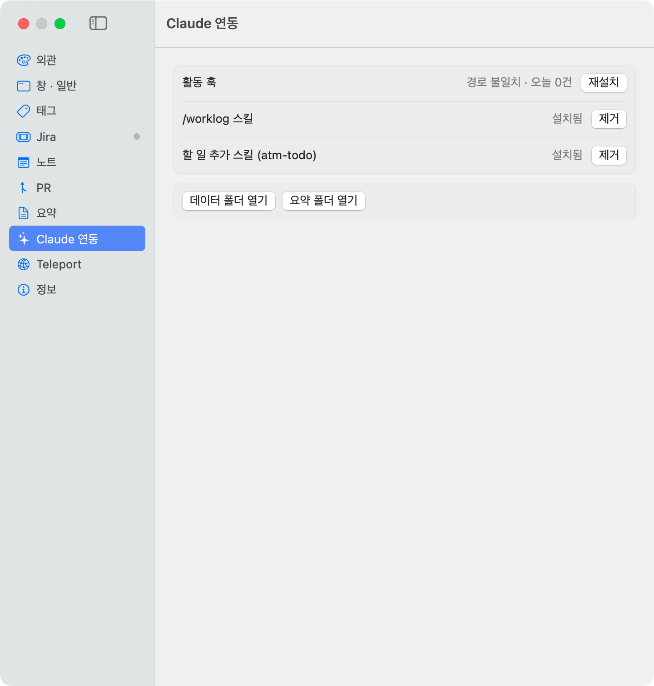 Claude 연동">

- **활동 훅**: Claude Code 대화를 요약 재료로 모은다. 상태 옆에 오늘 기록 수가 보이고, 경로가 어긋나면 **재설치**.
- **/worklog 스킬**, **할 일 추가 스킬(atm-todo)**: 설치·제거. `~/.claude/settings.json` 은 백업한 뒤 고친다.
- **데이터 폴더 열기 / 요약 폴더 열기**.

#### Teleport

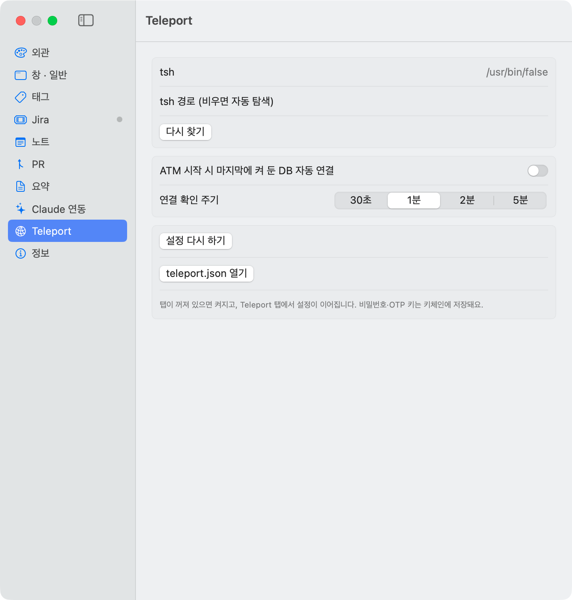 Teleport">

- **tsh 경로**: 비우면 자동으로 찾는다. 설치 뒤 **다시 찾기**.
- **ATM 시작 시 마지막에 켜 둔 DB 자동 연결**, **연결 확인 주기**(30초·1분·2분·5분).
- **설정 다시 하기**(계정·DB 다시 고르기), **teleport.json 열기**(그룹 이름 등 직접 고치기).

#### 정보

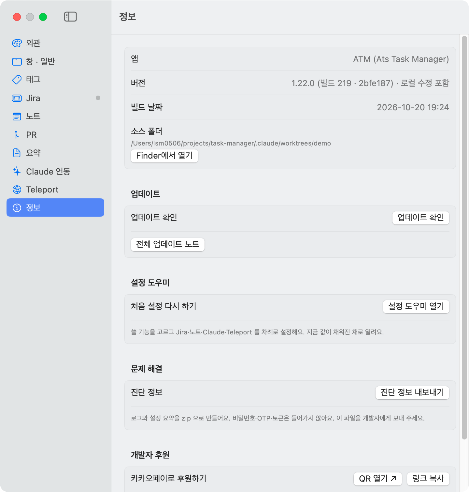 정보">

- 버전·빌드 날짜·소스 폴더, **업데이트 확인**과 **전체 업데이트 노트**.
- **설정 도우미 열기**: 처음 설정 마법사를 지금 값이 채워진 채로 다시 연다.
- **진단 정보 내보내기**: 문제가 생기면 바탕화면에 만들어지는 zip 을 개발자에게 전달한다 (비밀번호·토큰은 들어가지 않는다).
- 개발자 후원.

## 업데이트

설정 > 정보 > **업데이트 확인**에서 새 커밋을 확인하고 **업데이트** 버튼을 한 번 누르면 갱신된다 (`git pull --ff-only` + `make install`, 끝나면 앱이 다시 열린다). 새 버전은 30분마다, 그리고 패널을 열 때 확인하며, 있으면 패널 타이틀바에 "새 버전" 버튼이 뜬다. 소스 폴더에 커밋하지 않은 수정이 있으면 업데이트가 거부된다. 실패 로그는 `~/Library/Application Support/TaskWidget/logs/update.log` 에 남는다.

수동으로 하려면 소스 폴더에서 다음을 실행한다.

```bash
git pull
make install
```

재설치할 때마다 처음 Jira 를 불러올 때 키체인 창이 한 번 뜬다. **항상 허용**을 누르면 그 버전에서는 다시 묻지 않는다. 창이 떠 있어도 앱은 멈추지 않는다.

## 문제 해결

- **문제가 생기면**: 설정 > 정보 > 진단 정보 내보내기 → 바탕화면 zip 을 개발자에게 전달 (로그·환경 요약만 담기고 비밀번호·OTP·토큰은 들어가지 않는다).
- **빌드 중 `Invalid manifest` / `redefinition of module 'SwiftBridging'`**: 예전 명령줄 도구의 잔여 파일 때문이다. `make doctor` 로 확인하고 `sudo ./scripts/fix-clt.sh` 를 실행한다 (파일은 삭제하지 않고 `/Library/Developer/CLT-stale-backup/` 으로 옮긴다). 또는 `sudo rm -rf /Library/Developer/CommandLineTools && xcode-select --install` 로 재설치한다.
- **패널이 안 보임**: 메뉴바 아이콘이나 Dock 아이콘을 클릭한다.
- **Jira 에 "Jira 주소를 입력하세요"**: 업데이트로 기본 주소가 빠졌다. 설정 > Jira 에 회사 Jira 주소(`https://<사이트>.atlassian.net`)를 넣는다.
- **Jira 401**: 토큰을 다시 발급해 저장한다.
- **요약 실패 `claudeNotFound`**: 터미널에서 `command -v claude` 로 경로를 확인해 설정 > 요약 > claude 경로에 입력한다 (또는 **자동 찾기**).
- **요약이 "기록 없음"**: 활동 훅이 설치됐는지, 훅 설치 이후의 새 세션인지 확인한다.
- **키체인 창이 앱을 켤 때마다 뜸**: "허용" 대신 **항상 허용**을 눌렀는지 확인한다. 재설치 직후 한 번 뜨는 건 정상이다. Apple 개발자 팀 ID 없이 빌드한 앱이라 macOS 가 새 버전마다 다시 묻는다. 설정 > 창·일반 > 비밀 정보 저장 을 **파일**로 바꾸면 더는 뜨지 않는다 (대신 평문 저장, 아래 참고).
- **앱을 옮긴 뒤 훅이 동작하지 않음**: `~/.claude/settings.json` 의 훅 경로가 깨진 것이다. 설정 > Claude 연동에서 "재설치"한다.
- **이전 이름(TaskWidget.app)에서 업그레이드**: 설정 > Claude 연동에서 활동 훅을 재설치하고, 로그인 시 실행을 껐다 켠다.
- **삭제**: 먼저 설정 > Claude 연동에서 훅·스킬을 제거한 뒤, `~/Applications/ATM.app` 을 휴지통으로 옮기고 데이터 폴더 `~/Library/Application Support/TaskWidget/` 를 삭제한다.

## 데이터와 개인정보

모든 데이터는 내 Mac 안에 있다. 위치는 `~/Library/Application Support/TaskWidget/` 이다.

- `todos.json`, `tags.json`: 할 일과 태그
- `notes.json`: 노트 메모와 링크 (잠긴 메모 내용은 잠금 비밀번호로 암호화, 권한 600)
- `teleport.json`: Teleport 계정·DB 목록 (비밀번호 제외)
- `activity.jsonl`: 활동 훅이 남기는 Claude Code 활동 기록. **내가 입력한 프롬프트가 들어 있다.**
- `worklog/`: `/worklog` 로 남긴 일지
- `summaries/`: 생성된 요약
- `logs/`: 업데이트 등 로그
- 비밀 정보(Jira·Confluence API 토큰, Bitbucket API 토큰, Teleport 비밀번호·OTP 키, Touch ID 를 켰을 때 노트 잠금 열쇠)는 기본적으로 macOS 키체인에 저장된다. GitHub 은 `gh` 의 로그인을 그때그때 빌려 쓰고 따로 저장하지 않는다. 설정 > 창·일반 > 비밀 정보 저장 에서 **파일**을 고르면 `secrets.json` 에 **암호화 없이** 저장된다 (권한 600, 내 계정만 읽기 가능). 저장소 밖이라 git 에 올라가지 않는다. 전환하면 기존 값을 새 위치로 옮기고 이전 위치에서 지운다.

외부로 나가는 통신은 켠 기능에 따라 아래뿐이다. 그 외 서버로 데이터를 보내지 않는다.

- Jira·Confluence: 설정한 Atlassian 사이트 API (이슈·상태·별표 문서 조회, 상태 변경)
- GitHub: `api.github.com` (PR 조회, 승인), 업데이트 확인·설치 시 이 저장소 `git pull`
- Bitbucket: `api.bitbucket.org` (PR·저장소 조회, 승인)
- Teleport: `tsh` 로 설정한 프록시에 로그인·터널
- 노트 링크: 링크를 저장할 때 그 페이지 제목을 가져오려고 한 번 접속 (쿠키 없음)
- 요약: 로컬 `claude` CLI 실행 (Claude Code 가 Anthropic 으로 보냄)

## 개발자용

```bash
make build     # swift build
make test      # swift test (Core 단위 테스트)
make app       # build/ATM.app 생성 (로그인 키체인의 "TaskWidget Dev" 인증서로 서명, 없으면 ad-hoc)
make install   # ~/Applications/ATM.app 설치
make run       # build/ATM.app 실행
```

- 앱 아이콘: `swift scripts/make-icon.swift` 로 다시 생성한다 (`Resources/AppIcon.icns`).
- 설계 문서: `docs/superpowers/specs/2026-10-02-task-widget-design.md`
- 릴리스: `VERSION` 을 올리고(기능 추가 = minor, 버그 수정 = patch) `CHANGELOG.md` 맨 위에 `## <버전> — <날짜>` 섹션을 추가한다 (사용자 입장의 짧은 한글 항목). 같은 PR에 넣는다. 머지되면 GitHub Actions(`.github/workflows/release.yml`)가 `v<버전>` 태그와 GitHub Release 를 자동으로 만든다 (본문은 `scripts/release-notes.sh <버전>` 으로 뽑은 CHANGELOG 섹션).
- README 스크린샷: `make app && scripts/screenshot-demo.sh` 로 가짜 데이터(`docs/demo/`)가 든 데모 앱을 따로 띄워 찍는다. 실제 데이터·설정·키체인은 건드리지 않고 네트워크도 쓰지 않는다 ([docs/demo/README.md](docs/demo/README.md)).
- 릴리스 전 확인 목록: [docs/manual-test-checklist.md](docs/manual-test-checklist.md)
